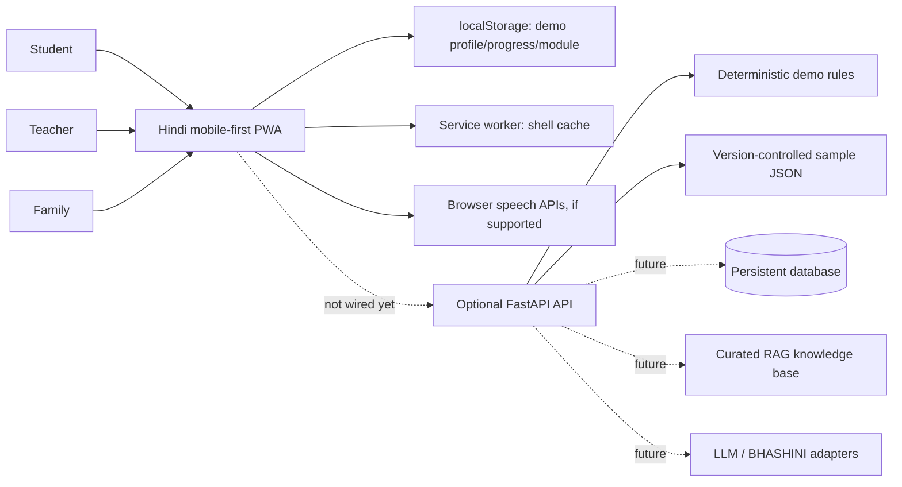

# Architecture and status

## Current prototype boundaries

Implemented in-browser: five tabs, rule-based skill suggestions, diverse career options, editable pathways and progress, selectable schematic opportunity pins/list fallback, teacher module generation (five steps + quiz), local mock publication/pricing, family four-part summary, speech/share fallbacks, local persistence and a basic shell cache.

Optional backend: FastAPI validation and demo endpoints; tests cover unknown eligibility, consent gating, sample opportunity labeling and module validation.

Not production-ready: authentication/authorization, guardian consent management, persistent database, secure multi-user profiles, full offline IndexedDB sync/conflict resolution, live official opportunity ingestion, real map tiles/geocoding, production RAG, hosted LLM integration, BHASHINI credentials/adapter, payment processing, production monitoring and automated browser/device testing.
